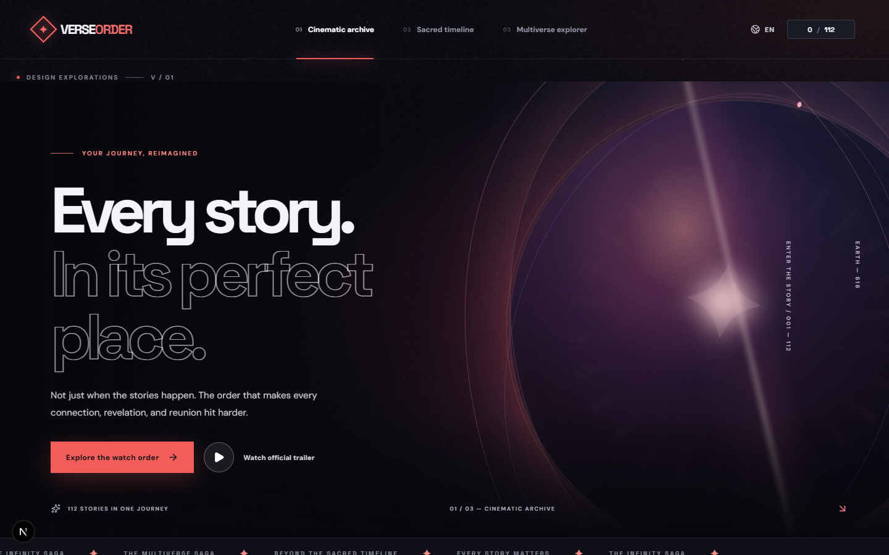
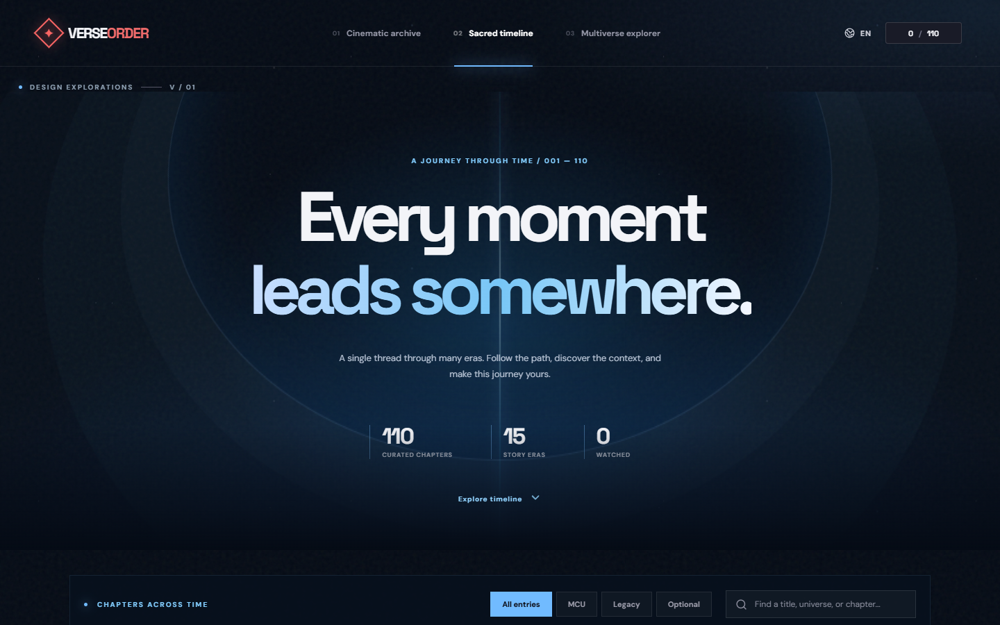
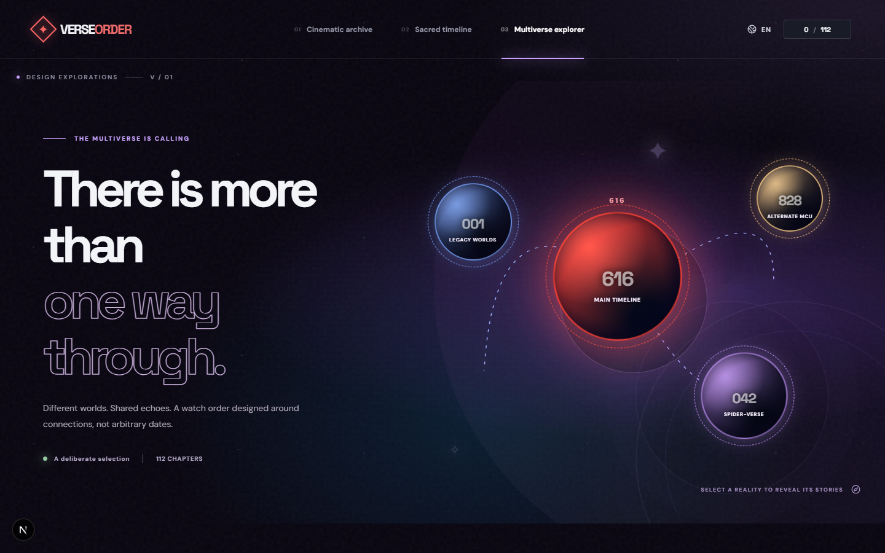

# VerseOrder

**The Ultimate Marvel Multiverse Watch Order**

[English](#english) · [Português](#português)

## English

VerseOrder is an independent, open-source viewing guide for Marvel films, series, shorts and interconnected legacy universes. It focuses on a **deliberate narrative watch order**, not merely the in-universe dates of events. A placement should earn its place by improving context, revealing connections at a satisfying moment or strengthening the viewing experience.

The initial curated snapshot contains **110 entries**. It is a starting point, not a claim of a universally definitive or officially endorsed chronology. The original snapshot was prepared in July 2026 and requires a new-release and editorial audit.

### Interactive design explorations

The local prototype includes three distinct, fully navigable art directions, selectable from the top navigation:

- **Cinematic Archive:** immersive cinematic front page, atmospheric hero, expanding cards and a curated watch sequence.
- **Sacred Timeline:** illuminated temporal path with eras, progress checkpoints and expandable title details.
- **Multiverse Explorer:** interactive worlds, connected orbits and universe-filtered browsing.

All three use one canonical collection. Available now: EN/PT-BR UI, title search, category filters, watched/unwatched progress persisted locally, details, and click-to-play verified official trailers for selected titles. Other trailers open a search rather than claiming an unverified source.

| Cinematic Archive | Sacred Timeline | Multiverse Explorer |
| --- | --- | --- |
|  |  |  |

These screenshots are just entry points. The full prototype has interactive animation, hover states and additional screens.

### Run locally

Requires Node.js (current maintained version) and npm.

```bash
npm ci
npm run dev
```

Open **http://localhost:3000**. To verify a production build:

```bash
npm run build
npm run lint
# Optional browser tests:
npx playwright install chromium
npm run test:e2e
```

This is currently a **static-export Next.js** app (see `next.config.ts`), so the generated `out/` folder can be deployed on static hosting. Hosting has not been selected or enabled.

### Editorial contributions

- `src/data/watch-order.json`: canonical, ordered snapshot. IDs must be stable; numbering is a display position, not an identifier.
- `content/watch-order.md`: human-readable watch sequence.
- `content/excluded.md`: exclusions tracked separately from the main journey.
- `docs/PRODUCT_SPEC.md`: behavior and long-term product vision.
- `docs/DECISIONS.md`: accepted decisions and unresolved choices.
- `docs/ROADMAP.md`: milestones.
- `docs/DESIGN_EXPLORATIONS.md`: design concepts and review criteria.
- `CONTRIBUTING.md`: proposal and PR guidance.

Tell us *why* a title should move or be added, provide an authoritative source where relevant, and consider spoilers for first-time viewers.

### Fan project and rights

Independent fan curation; **not affiliated with or endorsed by Marvel Entertainment, Marvel Studios, Disney, Sony or related rights holders**. Title names and trademarks remain the property of their respective owners. The website's visual experiments use original CSS artwork and a reusable Unsplash space photograph; no official promotional posters are redistributed here. Refer to `docs/ASSET_POLICY.md`.

## Português

O VerseOrder é um guia independente e de código aberto para assistir a filmes, séries e especiais Marvel numa **ordem pensada para a melhor experiência narrativa**. Não é apenas cronologia: prioriza conexões, contexto e impacto emocional.

A curadoria inicial possui **110 entradas** e está em revisão editorial para contemplar lançamentos e checagem de fontes. O protótipo oferece três direções visuais interativas, idioma inglês/português, filtros, busca e progresso salvo no próprio navegador.

Para executar, use `npm ci` e `npm run dev`. Consulte `docs/ROADMAP.md` e `docs/PRODUCT_SPEC.md` para a evolução planejada.
